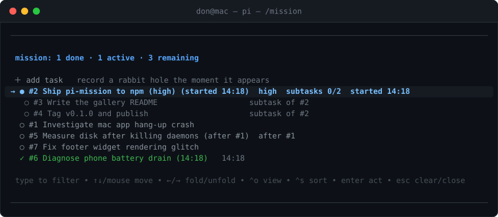

# pi-mission

Mission tracking for [pi](https://pi.dev). The extension records each piece of
work when it appears. It tracks the work while you work. It shows one list with
three parts: current work, completed work, and remaining work.



The popup marks the current mission with `→`. It indents subtasks under their
mission. It marks blocked work with `after #n`.

## Install

```bash
pi install npm:pi-mission
# or from git
pi install git:github.com/donpark/pi-mission
```

## What you get

**One searchable list.** `/mission` opens the list in a popup. The shortcuts
`⌥M`, `⌥J`, and `⌃⇧K` open the same popup. Type text to filter the list by
title or `#id`. Use `↑↓` or the mouse to move the selection. Press `Enter` for
the actions of one mission. Use `←→` to fold and unfold subtasks. `⌃O` selects
the view mode (all / open / current). `⌃S` selects the sort order (board /
recent / oldest / priority / status). `Home`, `End`, `PgUp`, and `PgDn` move
the selection fast. Press `Esc` to clear the filter, then to close the popup.

**Autonomous tracking.** The agent maintains the list as it works. It adds a
mission when work appears. It starts the mission when work begins. It marks the
mission done when work completes. You intervene only to change a state. The
popup sends each action as a `Mission override:` message.

**Names on capture.** You can add a rough thought instead of a name. A small
model then writes the name. The name has 3 to 7 words and starts with a verb.
Set `PI_MISSION_NAME_MODEL` to choose the model. The extension never calls your
session model for this, so it adds no cost on expensive models.

**Structure.** A mission can have subtasks (one level). A mission can have
prerequisites (`depends_on`). The tool rejects prerequisite cycles. A mission
has a priority: `high`, `normal`, or `low`. The list sorts remaining work by
the prerequisite graph and marks blocked work with `after #n`.

**Persistence.** Each change updates `~/.pi/agent/missions.json`. Set
`PI_MISSION_STORE` to change the location. A new session adopts your open
work. Completed work remains as history. A bundled skill teaches other agents
how to find and update these missions.

**Cost.** pi-mission makes one kind of model call: it names captures with the
small model. All other work is file input and output. The tool adds about 200
tokens to each request while it is active.

## Granularity

`PI_MISSION_GRANULARITY` controls how much work becomes a mission:

- `fine` — record every step and every side quest.
- `normal` — record each piece of work; use subtasks for its steps (default).
- `coarse` — record only work items that have several steps.

## Terminal note

The `⌥` shortcuts need option-as-alt from the terminal. In Ghostty, set
`macos_option_as_alt = true`. This setting also enables the pi editor motions
`⌥B`, `⌥D`, and `⌥F`. The `⌃⇧K` shortcut needs no configuration in CSI-u
terminals.

## Development

```bash
node extensions/pi-mission/selftest.mjs
```

## Publish

The `pi-package` keyword lists the package in the
[pi package gallery](https://pi.dev/packages). The host packages
(`@earendil-works/*`, `typebox`) are `peerDependencies` only. pi supplies them.

```bash
npm publish --access public
```

## License

MIT
